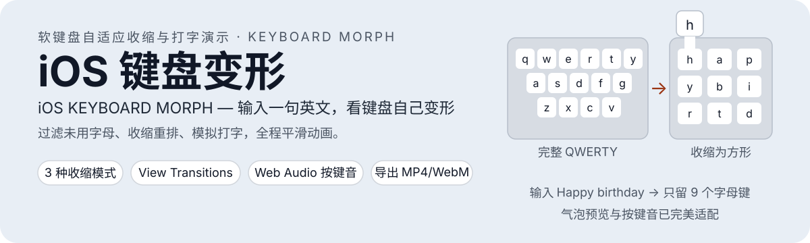
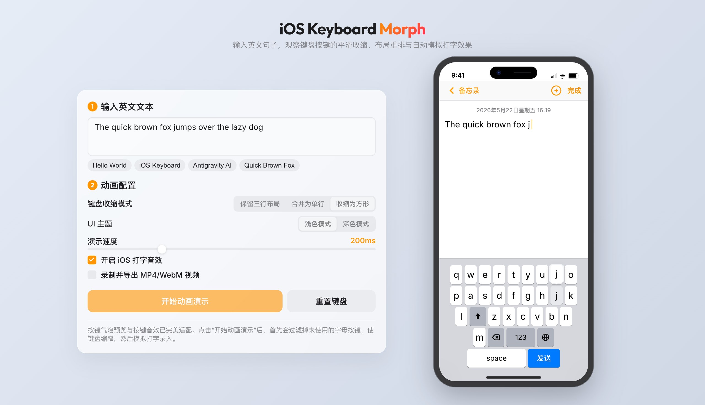

<p align="right"><a href="README.md">中文</a></p>

<p align="center">
  
</p>

<p align="center">
  <a href="https://xiaosang.cc/keyboard-sentence/">▶ Live Demo</a>
  ·
  <a href="https://holynova.github.io/keyboard_sentence/">GitHub Pages</a>
  ·
  <a href="https://github.com/holynova/keyboard_sentence">GitHub Repository</a>
</p>

iOS Keyboard Morph is an iOS keyboard adaptive-layout simulator: type an English sentence and the keyboard first filters out unused letter keys, morphs smoothly into a compact layout, then types the sentence out with iOS-style key popups and synthesized key sounds. You can record the demo as a video with sound.

## Demo

<video src="./assets/demo.mp4" controls width="320" style="border-radius: 12px; box-shadow: 0 8px 24px rgba(0,0,0,0.15); max-width: 100%;"></video>

*(If the video doesn't play inline in GitHub Markdown, open [assets/demo.mp4](./assets/demo.mp4) directly.)*

## Screenshot

<p align="center">
  
</p>

## Features

- **3 morph modes**: keep three rows (`row-shrink`), merge into a single row (`single-row`), or pack into a best-aspect-ratio square (`square-pack`).
- **View Transitions API motion**: native smooth sliding rearrangement, with no flicker or jumps when keys reflow.
- **Realistic typing**: iOS key sounds synthesized live with the Web Audio API, plus the classic iOS key popup preview.
- **Record and export video**: capture the screen in one click and record an MP4 / WebM video with key sounds, merged in the browser; or export the final frame as an image.
- **7 presets**: Happy birthday, I love you, Happy New Year, Merry Christmas, Best wishes, Congratulations, QWERTY Test (The quick brown fox jumps over the lazy dog) — tap one to fill it in.
- **Look and themes**: refined iOS-realistic design with a glassmorphic console, light / dark mode adaptive, adjustable demo speed.

## How to Use

1. **Enter a sentence**: type a short English sentence (e.g. `Good morning`) in the text box, or tap a preset.
2. **Pick a mode**: choose a morph mode (e.g. 「收缩为方形」 "Shrink to Square"), plus theme and demo speed.
3. **Start the demo**: tap 「开始动画演示」 ("Start Animated Demo") — unused letter keys are filtered out, the keyboard morphs, then the sentence is typed out.

## Run Locally

Zero build, vanilla HTML / CSS / JS — just serve it:

```bash
npm run dev     # http-server, http://localhost:3000
```

Or open `index.html` with any static server.

## Tech

- Vanilla HTML / CSS / JS, zero dependencies, zero build.
- Layout morphing uses the View Transitions API (`document.startViewTransition`); key sounds are synthesized live with the Web Audio API; video is recorded and merged in-browser with MediaRecorder.
- The iPhone simulator frame and control panel are in `index.html`; layout, glassmorphic styles, and View Transitions definitions are in `style.css`; simulated typing, audio synthesis, video rendering, and transition logic are in `app.js`.

```
index.html   iPhone simulator frame and control panel
style.css    Layout, glassmorphic styles, View Transitions definitions
app.js       Simulated typing, audio synthesis, video rendering, transition logic
assets/      Demo video demo.mp4 and screenshots
```
