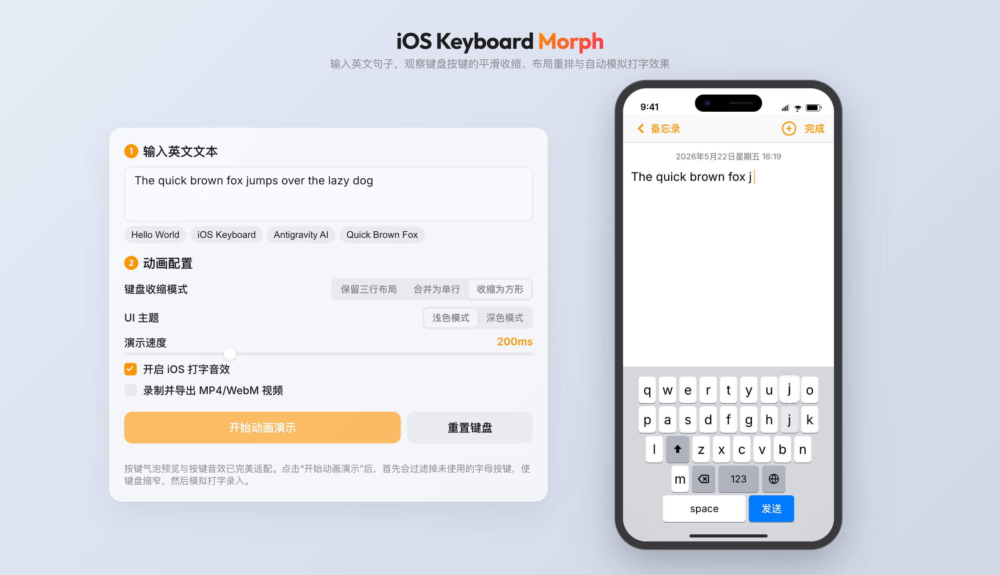

# iOS Keyboard Morph - 软键盘自适应收缩与打字演示

一个精美的 iOS 键盘布局自适应收缩与打字动画模拟器。

👉 **[🌐 在线预览体验](https://holynova.github.io/keyboard_sentence/)**

---

## 🌟 项目特色

- **自适应收缩布局**：支持保留三行 (`row-shrink`)、单行合并 (`single-row`) 及最佳宽高比的方形排布 (`square-pack`)。
- **View Transitions API 动效**：原生平滑滑动重排，完美消除按键折行时的闪烁与跳跃。
- **高拟真打字体验**：基于 Web Audio API 动态合成的 iOS 键盘按键音与 iOS 经典的气泡弹出预览（`Key Popup`）。
- **视频录制与导出**：一键捕获画面并在浏览器内合并录制带按键声的 `.mp4` 视频。
- **高级视觉与主题**：精致的 iOS 拟真设计与玻璃拟态控制台，支持完美自适应的 Dark Mode。

---

## 📷 效果演示

### 视频演示
[观看键盘收缩与打字演示视频（MP4）](assets/demo.mp4)

### 静态截图


---

## 🚀 快速上手

```bash
# 启动本地开发服务 (在 http://localhost:3000 查看)
npm run dev
```

1. **输入语句**：在文本框内输入日常短句（如 `Good morning`）。
2. **选择模式**：点击选择收缩模式（如 `收缩为方形`）。
3. **开始演示**：点击 `开始动画演示` 即可。

---

## 🛠️ 文件结构
- `index.html` — iPhone 模拟器骨架与控制面板
- `style.css` — 布局、玻璃拟态样式及 View Transitions 定义
- `app.js` — 模拟打字、音频合成、视频渲染与过渡逻辑
- `assets/` — 存放项目截图与演示视频文件
