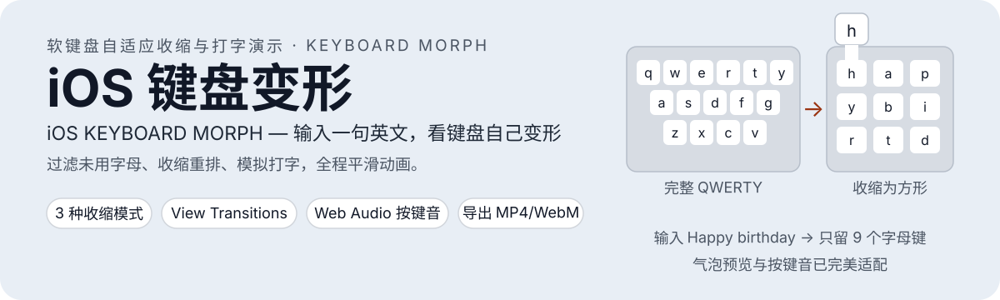
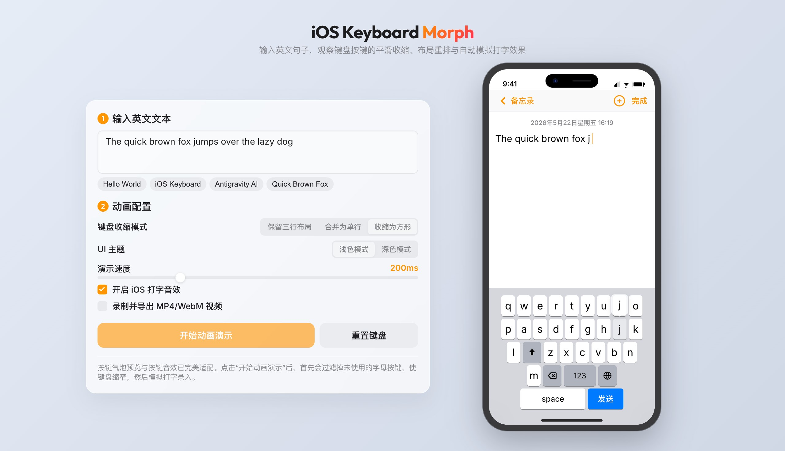

<p align="right"><a href="README.en.md">English</a></p>

<p align="center">
  
</p>

<p align="center">
  <a href="https://xiaosang.cc/keyboard-sentence/">▶ 在线体验</a>
  ·
  <a href="https://holynova.github.io/keyboard_sentence/">GitHub Pages</a>
  ·
  <a href="https://github.com/holynova/keyboard_sentence">GitHub 仓库</a>
</p>

iOS 键盘变形是一款 iOS 键盘布局自适应收缩与打字动画模拟器：输入一句英文句子，键盘先过滤掉未使用的字母按键、平滑收缩重排，再模拟打字录入。带 iOS 风格的气泡按键预览与动态合成的按键音，还能把演示录制成带声视频导出。

## 演示

<video src="./assets/demo.mp4" controls width="320" style="border-radius: 12px; box-shadow: 0 8px 24px rgba(0,0,0,0.15); max-width: 100%;"></video>

*（如果在 GitHub Markdown 中无法直接播放，请打开 [assets/demo.mp4](./assets/demo.mp4) 观看。）*

## 截图

<p align="center">
  
</p>

## 功能

- **3 种收缩模式**：保留三行布局（`row-shrink`）、合并为单行（`single-row`）、最佳宽高比的方形排布（`square-pack`）。
- **View Transitions API 动效**：原生平滑滑动重排，消除按键折行时的闪烁与跳跃。
- **高拟真打字体验**：基于 Web Audio API 动态合成的 iOS 键盘按键音，与 iOS 经典的气泡弹出预览（Key Popup）。
- **视频录制与导出**：一键捕获画面，在浏览器内合并录制带按键声的 MP4 / WebM 视频；也可导出最终图片。
- **7 句预设**：Happy birthday、I love you、Happy New Year、Merry Christmas、Best wishes、Congratulations、QWERTY Test（The quick brown fox jumps over the lazy dog），点一下即填入。
- **视觉与主题**：精致的 iOS 拟真设计与玻璃拟态控制台，浅色 / 深色模式自适应；演示速度可调。

## 使用

1. **输入语句**：在文本框内输入英文短句（如 `Good morning`），或点预设句。
2. **选择模式**：点击选择收缩模式（如「收缩为方形」），可选主题与演示速度。
3. **开始演示**：点击「开始动画演示」——先过滤未用字母键、键盘收缩，再模拟打字录入。

## 本地运行

零构建，纯 HTML / CSS / JS，直接起静态服务：

```bash
npm run dev     # http-server，http://localhost:3000
```

或用任意静态服务器打开 `index.html`。

## 技术

- 原生 HTML / CSS / JS，零依赖、零构建。
- 布局变形用 View Transitions API（`document.startViewTransition`）；按键音用 Web Audio API 动态合成；视频用 MediaRecorder 在浏览器内录制合并。
- iPhone 模拟器骨架与控制面板在 `index.html`；布局、玻璃拟态样式与 View Transitions 定义在 `style.css`；模拟打字、音频合成、视频渲染与过渡逻辑在 `app.js`。

```
index.html   iPhone 模拟器骨架与控制面板
style.css    布局、玻璃拟态样式、View Transitions 定义
app.js       模拟打字、音频合成、视频渲染与过渡逻辑
assets/      演示视频 demo.mp4 与截图
```
